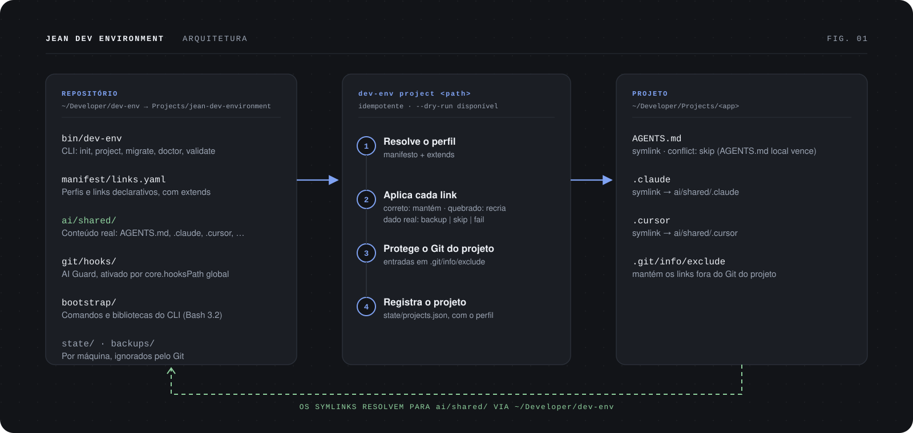
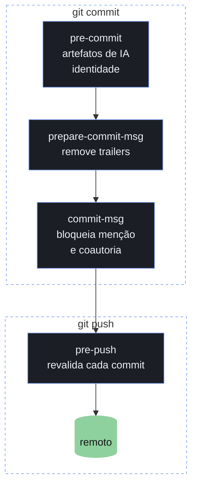
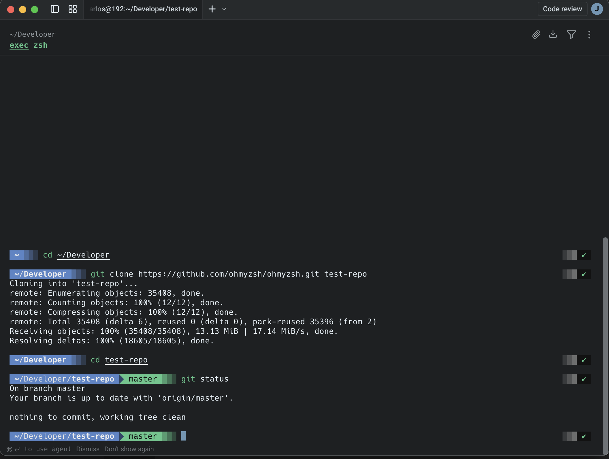
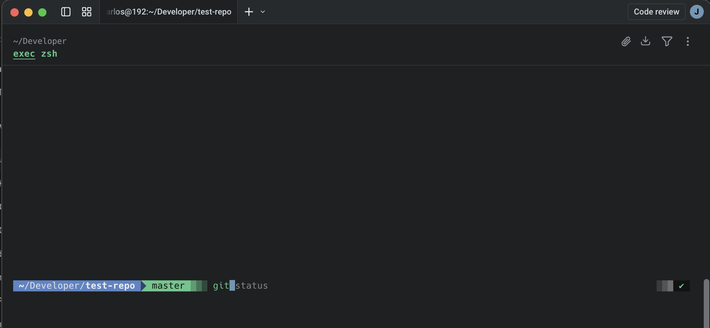
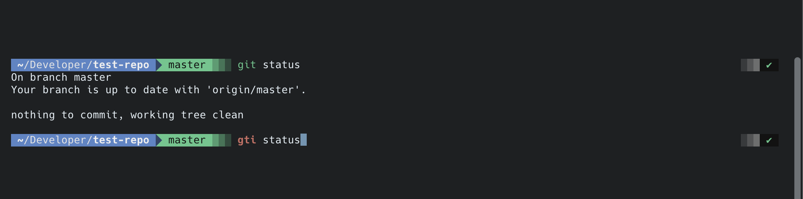
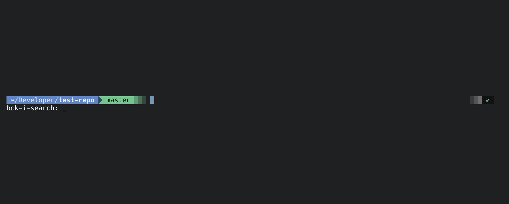

<a id="topo"></a>

<p align="center">
  <picture>
    <source media="(prefers-reduced-motion: reduce)" srcset="docs/assets/readme/hero-still.svg" />
    
  </picture>
</p>

<h1 align="center">Jean Dev Environment</h1>

<p align="center">
  <strong>Configure uma vez. Todo projeto herda.</strong><br />
  Fonte única de verdade para o ambiente de desenvolvimento com agentes de IA: symlinks declarativos, regras compartilhadas e o AI Guard nos hooks Git, mantidos por um CLI idempotente.
</p>

<p align="center">
  <a href="LICENSE"></a>
  
</p>

<p align="center">
  <a href="#comece-aqui"><strong>COMEÇAR →</strong></a>
  &nbsp;·&nbsp;
  <a href="#como-funciona">COMO FUNCIONA</a>
  &nbsp;·&nbsp;
  <a href="#comandos">COMANDOS</a>
  &nbsp;·&nbsp;
  <a href="#ai-guard">AI GUARD</a>
  &nbsp;·&nbsp;
  <a href="#troubleshooting">TROUBLESHOOTING</a>
</p>

---

## 01 · Por que existe

Configuração de agentes (Claude Code, Cursor, MCP e o que vier depois) costuma viver dentro de cada repositório de cliente. Lá ela é duplicada, diverge entre projetos e some com um `git clean -fdx`.

O `dev-env` inverte isso. O conteúdo real mora **fora** dos repositórios de cliente. Cada projeto recebe apenas **symlinks**. Assim um `git clean -fdx` nunca mais apaga configuração: ele remove o link, o conteúdo continua intacto no `dev-env`, e um único comando recria tudo.

| Problema | Como o `dev-env` resolve |
|---|---|
| Configuração apagada por `git clean -fdx` | Projetos só têm symlinks; `dev-env project` recria em segundos |
| Regras duplicadas e divergentes entre projetos e ferramentas | Um único `ai/shared/AGENTS.md`; as ferramentas recebem adapters que apenas apontam para ele |
| Configuração de IA vazando para o Git do cliente | Links listados em `.git/info/exclude` e no ignore global; AI Guard bloqueia commits |
| Setup manual e irreprodutível | Manifesto declarativo + CLI idempotente com `--dry-run` |

<a id="como-funciona"></a>

## 02 · Como funciona

```text
~/Developer/
├── Projects/
│   └── <cliente>/
│       ├── AGENTS.md  ─┐  (symlinks — ignorados pelo git,
│       ├── .claude     │   recriáveis a qualquer momento)
│       └── .cursor    ─┘
│
└── dev-env  ──►  Projects/jean-dev-environment   (symlink mestre estável)
```

- **`~/Developer/dev-env`** é um symlink mestre para este repositório. É o caminho estável que todos os projetos referenciam.
- **`ai/shared/`** guarda o conteúdo compartilhado entre projetos.
- Um **manifesto declarativo** (`manifest/links.yaml`) descreve quais links cada projeto recebe.
- Um **CLI** (`dev-env`) cria, migra, valida, audita e repara tudo de forma idempotente.

### Arquitetura

<p align="center">
  
</p>

| Componente | Responsabilidade | Onde |
|---|---|---|
| CLI | Ponto de entrada; interpreta flags globais e carrega o comando | `bin/dev-env` |
| Comandos | `init`, `project`, `migrate`, `doctor`, `validate` | `bootstrap/commands/` |
| Bibliotecas | Log e relatório, parser YAML, manifesto, aplicação de links, Git | `bootstrap/lib/` |
| Manifesto | Perfis e links, sem comandos hardcoded | `manifest/links.yaml` |
| Conteúdo compartilhado | Regras, adapters e conhecimento | `ai/shared/` |
| AI Guard | Hooks Git globais | `git/hooks/` |
| Estado local | Registro dos projetos e backups, por máquina, fora do Git | `state/`, `backups/` |

## 03 · Ferramentas e integrações

Além dos symlinks, o `dev-env` distribui um **conjunto único de regras compartilhadas** para desenvolvimento assistido por agentes. A fonte da verdade é um arquivo só:

```text
ai/shared/AGENTS.md
```

O perfil `default` instala esse arquivo como `AGENTS.md` na raiz do projeto — convenção lida por diversos agentes. Ferramentas com convenção própria recebem um adapter que apenas **aponta** para ele, nunca duplica regra:

```text
AGENTS.md (raiz do projeto)  ──────────┐
.claude/CLAUDE.md                      ├──► ai/shared/AGENTS.md
.cursor/rules/core.mdc                 ──┘
```

| Ferramenta | O que recebe | Como lê as regras |
|---|---|---|
| Agentes que leem `AGENTS.md` | `AGENTS.md` na raiz (symlink) | Diretamente |
| Claude Code | `~/.claude/CLAUDE.md` (link da máquina, criado pelo `init`) e `.claude/` no projeto | Os dois `CLAUDE.md` importam `@~/Developer/dev-env/ai/shared/AGENTS.md`; o da máquina vale em qualquer repositório |
| Cursor | `.cursor/` no projeto | `.cursor/rules/core.mdc` (`alwaysApply: true`) manda seguir o mesmo arquivo |

> [!NOTE]
> O Cursor só documenta regras em arquivo **por projeto** (`.cursor/rules/`, `AGENTS.md`). Regras globais são as *User Rules* da interface (Customize → Rules), sem caminho de arquivo, por isso o `dev-env` não cria nada em `~/.cursor`. Fora de projetos configurados, cole nas User Rules uma linha como "Siga as regras de `~/Developer/dev-env/ai/shared/AGENTS.md`".

Projeto que já tenha um `AGENTS.md` próprio não é sobrescrito: o link é `conflict: skip` e o arquivo local prevalece.

O conhecimento técnico acumulado (investigações, causa raiz, evidências) mora separado, em [`ai/shared/knowledge/engineering-learnings.md`](ai/shared/knowledge/engineering-learnings.md).

### Filosofia de engenharia

- **Engenharia antes da ferramenta** — as regras descrevem comportamento de engenharia, não preferência por uma IA.
- **Causa raiz antes de workaround** — mitigar sintoma não encerra investigação.
- **Evidência antes de inferência** — fato, hipótese, inferência e decisão são coisas distintas.
- **Arquitetura antes de refatoração** — entender o existente antes de mudar.
- **Escopo mínimo, menor diff** — achado fora de escopo é registrado, não implementado junto.
- **Git seguro** — auditoria de branch, checklists de pré-commit e pré-push, nenhuma ação destrutiva sem autorização explícita.
- **Documentação viva** — a documentação representa o padrão vigente; o histórico pertence ao Git.
- **Aprendizado contínuo** — `Decision → Rule → Learning`, cada etapa com um dono e sem texto duplicado.

### Compatibilidade

As regras são agnósticas de ferramenta. Claude, Cursor, ChatGPT, Codex, Gemini, Copilot e agentes futuros consomem exatamente o mesmo `AGENTS.md`. Limitação de uma ferramenta específica é exceção operacional registrada, nunca uma reescrita da regra global.

### Customização por projeto

Cada projeto **descobre e respeita a própria convenção** — não existe padrão universal imposto pelo `dev-env`:

- convenção de commits;
- estratégia de branches e nome da branch base;
- template de PR (`.github/pull_request_template.md`);
- CI;
- lint;
- testes.

Adapte o projeto, não as regras globais. Nunca edite o `AGENTS.md` para acomodar uma única ferramenta ou um único repositório.

<a id="comece-aqui"></a>

## 04 · Comece aqui

### Instalar (`init`)

```bash
git clone <repo> ~/Developer/Projects/jean-dev-environment
cd ~/Developer/Projects/jean-dev-environment
./bin/dev-env init
```

O `init` é idempotente e faz:

1. cria o symlink mestre `~/Developer/dev-env` → este repo;
2. garante a estrutura `ai/shared/`;
3. valida o manifesto;
4. configura o git ignore global (`~/.config/git/ignore`);
5. avisa se um `core.excludesfile` legado anula esse ignore;
6. adiciona `dev-env/bin` ao `PATH` (bloco delimitado no `~/.zshrc`);
7. aponta o `core.hooksPath` global para `git/hooks` (AI Guard);
8. cria os links da máquina declarados em `machine:` no manifesto (hoje `~/.claude/CLAUDE.md`), sem substituir arquivo seu, e remove links gerenciados que saíram do manifesto;
9. autoriza este repositório a versionar os próprios artefatos de IA.

Abra um novo shell e o comando `dev-env` fica disponível de qualquer lugar.

> [!WARNING]
> Se o symlink mestre ou o `core.hooksPath` global já apontarem para outro lugar, o `init` **não sobrescreve**: reporta o conflito e deixa a configuração intocada para você resolver à mão.

### Fluxo recomendado para projeto novo

```bash
# 1. (uma vez por máquina) preparar o ambiente
dev-env init

# 2. clonar o projeto do cliente
git clone <cliente> ~/Developer/Projects/novo

# 3. criar os links (escolha o perfil se precisar)
dev-env project ~/Developer/Projects/novo

# 4. conferir
dev-env validate ~/Developer/Projects/novo
```

<a id="comandos"></a>

## 05 · Comandos

| Comando | O que faz | Muda algo? |
|---|---|---|
| `dev-env init` | Setup único por máquina | Sim (idempotente) |
| `dev-env project <path> [--profile P]` | Cria/repara os links de um projeto | Sim (idempotente) |
| `dev-env migrate <path> [--profile P]` | Move configuração real para o `dev-env` e cria os links | Sim |
| `dev-env doctor [<path>...\|--all]` | Auditoria ampla | Não |
| `dev-env validate <path> [--profile P]` | Smoke tests | Não |
| `dev-env help` | Ajuda | Não |

Flags globais, em qualquer posição: `--dry-run` (descreve as mutações sem mudar nada), `--profile <nome>` (padrão: `default`), `--verbose`, `-h` / `--help`.

### Adicionar um projeto (`project`)

Cria/repara os symlinks de um projeto conforme o perfil.

```bash
dev-env project ~/Developer/Projects/meu-app
dev-env project ~/Developer/Projects/meu-app --profile <nome>
dev-env project ~/Developer/Projects/meu-app --dry-run    # só mostra
```

- Se o link já estiver correto → não faz nada.
- Se estiver quebrado ou apontando errado → recria.
- Se houver **dado real** no lugar → faz backup antes (política `conflict` do manifesto) e então cria o link.
- Escreve as entradas em `.git/info/exclude` (o `.gitignore` do cliente não é tocado) e registra o projeto.

### Migrar um projeto existente (`migrate`)

Quando o projeto **já tem** `.claude/.cursor/...` reais e você quer movê-los para o `dev-env` e substituí-los por links:

```bash
dev-env migrate ~/Developer/Projects/legado
dev-env migrate ~/Developer/Projects/legado --dry-run
```

Para cada item com dado real:

- **backup** (cópia fiel, preserva permissões/timestamps/xattrs) →
- **move** para `ai/shared` (só se o destino central estiver vazio) →
- **cria o symlink** apontando para o `dev-env`.

> [!IMPORTANT]
> Se o destino central **já tiver conteúdo**, é um **conflito**: o comando **para imediatamente**, não sobrescreve e não faz merge. Resolva à mão e rode de novo. O projeto só entra no registro quando a migração termina 100%.

### Validar (`validate`)

Smoke tests focados: as ferramentas achariam a config?

```bash
dev-env validate ~/Developer/Projects/meu-app
dev-env validate ~/Developer/Projects/meu-app --profile <nome>
```

Checa: todos os links resolvem, Claude acha `.claude`, Cursor acha `.cursor` e, quando um perfil linka `.mcp.json`, que ele é JSON válido. Sai com código ≠ 0 se algo falhar.

### Auditar (`doctor`)

Auditoria ampla, read-only.

```bash
dev-env doctor                       # só o ambiente
dev-env doctor ~/Developer/Projects/meu-app
dev-env doctor --all                 # todos os projetos registrados
```

Verifica symlink mestre, estrutura `ai/shared`, manifesto, `core.hooksPath`, links da máquina (`machine:`), e por projeto: links quebrados/ausentes/apontando errado, permissões, `info/exclude`, Claude/Cursor/MCP. `--all` usa automaticamente o **perfil registrado de cada projeto**. Sai com código ≠ 0 se houver falha (CI-friendly).

## 06 · Configuração

### `manifest/links.yaml`

O manifesto declara os links. Sem comandos hardcoded.

```yaml
version: 1

defaults:
  required: true        # source ausente: falha (true) ou pula (false)
  conflict: backup      # target com dado real: backup | skip | fail

profiles:
  default:
    profileVersion: 2
    links:
      - source: ai/shared/AGENTS.md
        target: AGENTS.md
        conflict: skip        # projeto com AGENTS.md próprio tem prioridade
      - source: ai/shared/.claude
        target: .claude
      - source: ai/shared/.cursor
        target: .cursor

machine:                        # aplicado pelo `dev-env init`, uma vez por máquina
  links:
    - source: ai/shared/.claude/CLAUDE.md
      target: .claude/CLAUDE.md # relativo ao $HOME
      conflict: skip            # arquivo seu nunca é substituído
```

- `source` é relativo à raiz do `dev-env`; `target` é relativo à raiz do projeto (perfis) ou ao `$HOME` (`machine:`).
- `machine:` usa o mesmo formato de link dos perfis. O `init` registra em `state/machine-links` o que criou: um link retirado do manifesto é removido no próximo `init`, mas só se ainda for symlink para o `dev-env`.
- `required`/`conflict` têm padrão em `defaults` e podem ser sobrescritos por link.
- Regras do formato: indentação de 2 espaços, sem tabs, sem arrays inline, sem âncoras. Quebrou a regra → o parser falha alto (não adivinha).

### Perfis

- **`default`** — o conjunto compartilhado por todo projeto: o `AGENTS.md` na raiz (convenção lida por diversos agentes) mais os adapters `.claude` e `.cursor`, que apenas apontam para ele.

Novo perfil = novas linhas no manifesto (com `extends` quando fizer sentido). O perfil usado por cada projeto fica gravado no registro, então `doctor --all` aplica o perfil certo automaticamente.

<a id="ai-guard"></a>

## 07 · Segurança e hooks

### Garantias do sistema

- **Idempotente** — rodar 2× dá o mesmo resultado; nada é recriado ou duplicado à toa.
- **Backups automáticos** — timestamped em `backups/<data>/`, nunca sobrescrevem, nunca reutilizam pasta, nunca apagam.
- **Nunca sobrescreve `ai/shared`** — migração só ocupa destino central vazio; `.gitkeep` conta como vazio (placeholder).
- **Nunca faz merge automático** — conflito de migração para na hora e reporta.
- **`--dry-run` disponível** — em toda operação mutável; mostra exatamente o que aconteceria, sem tocar em nada, e o relatório final é marcado como `DRY RUN`.
- **AI Guard** — hooks git globais (`git/hooks/`, ativados pelo `init`) mantêm o histórico livre de trailers, coautoria e artefatos de IA. A política é definida em `ai/shared/AGENTS.md`.

### AI Guard

O `init` aponta o `core.hooksPath` global para `git/hooks/`. A partir daí, todo repositório da máquina passa por quatro hooks de guarda:



| Hook | Bloqueia ou corrige |
|---|---|
| `pre-commit` | Bloqueia artefatos de IA staged (`.claude`, `CLAUDE.md`, `.cursor`, `AGENTS.md` e equivalentes) e identidade inválida: autor/committer de ferramenta ou bot, committer diferente do `user.name`/`user.email` configurado |
| `prepare-commit-msg` | Remove trailers e assinaturas de IA da mensagem (cobre `-m`, templates, merges e squashes) |
| `commit-msg` | Remove trailers restantes; bloqueia mensagem que ainda mencione ferramenta de IA e **qualquer** `Co-Authored-By` |
| `pre-push` | Revalida cada commit a enviar (mensagem, trailers, coautoria, identidade) |

- Nenhum hook reescreve autor ou committer: eles só bloqueiam.
- Cada hook encadeia o hook do próprio repositório (`.git/hooks/<nome>`) quando existir. Os demais hooks padrão em `git/hooks/` são links para `lib/passthrough.sh`, que só delega — hooks corporativos continuam funcionando.

**Repositório autorizado a versionar artefatos de IA** (como este): opt-in local, por repositório, nunca versionado.

```bash
git config ai-guard.allowArtifacts true
```

> [!CAUTION]
> `AI_GUARD_MAINTENANCE=1` desliga a guarda e imprime um aviso ruidoso. Existe **apenas** para manutenção consciente do próprio ambiente: nunca em trabalho normal, nunca em repositório de terceiros, nunca exportado no shell.

**Artefatos ocultos pelo ignore global.** Mesmo com `allowArtifacts`, o ignore global (`~/.config/git/ignore`) continua escondendo `CLAUDE.md`, `AGENTS.md`, `.claude/` e `.cursor/`. Diagnostique com `git check-ignore -v <arquivo>` e adicione os arquivos autorizados um a um com `git add -f`. Detalhes em [engineering-learnings.md](ai/shared/knowledge/engineering-learnings.md).

## 08 · Estrutura de diretórios

```text
jean-dev-environment/            (= ~/Developer/dev-env)
├── bin/dev-env                  # CLI
├── manifest/links.yaml          # manifesto declarativo dos symlinks
├── ai/shared/                   # fonte da verdade compartilhada
│   ├── AGENTS.md                # regras compartilhadas (arquivo dono)
│   ├── .claude/CLAUDE.md        # adapter do Claude Code
│   ├── .cursor/rules/core.mdc   # adapter do Cursor
│   ├── .agents  _bmad           # placeholders, fora do perfil default
│   ├── mcp/                     # configurações de MCP (vazio)
│   ├── prompts  snippets  templates
│   └── knowledge  docs          # knowledge/engineering-learnings.md
├── bootstrap/                   # implementação do CLI (comandos + libs)
├── git/hooks/                   # AI Guard (core.hooksPath global)
├── scripts/mac-dev-setup.sh     # setup de máquina (zsh) — ver no fim
├── docs/assets/readme/          # ilustrações deste README
├── state/                       # registro dos projetos e dos links da máquina
└── backups/                     # backups timestamped (por máquina)
```

`state/` e `backups/` estão no `.gitignore`: são locais de cada máquina.

<a id="troubleshooting"></a>

## 09 · Diagnóstico e troubleshooting

### Link quebrado / apontando errado

```bash
dev-env doctor ~/Developer/Projects/meu-app   # diagnostica
dev-env project ~/Developer/Projects/meu-app  # recria/repara
```

### Recuperação após `git clean -fdx`

O `git clean -fdx` remove os symlinks do projeto — mas **o conteúdo real continua salvo** em `ai/shared`. Para recriar tudo:

```bash
dev-env project ~/Developer/Projects/meu-app
# ou, para todos de uma vez:
dev-env doctor --all        # mostra o que quebrou
# depois rode project em cada um que precisar
```

Nada é perdido. Os links voltam em segundos.

### Conflito de migração

Mensagem: `CONFLICT: central already has content`.

O `ai/shared/<x>` já tem conteúdo diferente. Não há merge automático. Compare os dois, decida qual mantém, ajuste à mão e rode `migrate` de novo. O backup do projeto está em `backups/<data>/`.

### Comando `dev-env` não encontrado (PATH)

Rode `dev-env init` e abra um novo shell. O `init` adiciona um bloco delimitado (`# >>> dev-env >>>`) ao `~/.zshrc`. Confira se existe.

### Manifesto inválido

```bash
dev-env doctor        # aponta "manifest invalid"
```

Cheque `manifest/links.yaml`: indentação de 2 espaços, sem tabs, só as chaves conhecidas. O parser indica a linha do problema.

### Ignore global sem efeito

Se `git config --global core.excludesfile` apontar para outro arquivo, o Git deixa de ler `~/.config/git/ignore` e os links podem aparecer como untracked. O `init` avisa; consolide os padrões em um único arquivo ou remova a configuração legada.

### `~/.claude/CLAUDE.md` é um arquivo seu

O `init` não substitui o arquivo (`conflict: skip`) e o `doctor` avisa. Para carregar as regras compartilhadas, mova o arquivo e rode `dev-env init` de novo, ou acrescente nele a linha `@~/Developer/dev-env/ai/shared/AGENTS.md`.

### Commit bloqueado pelo AI Guard

Leia a mensagem do hook: ela diz o que bloqueou (menção a IA, coautoria, artefato staged, identidade). Corrija a mensagem ou o staging e tente de novo. Nunca contorne com `--no-verify`.

## 10 · Setup de máquina (zsh) — opcional

O `scripts/mac-dev-setup.sh` continua disponível para preparar o shell (Powerlevel10k, autosuggestions, syntax highlight, fzf). É independente do `dev-env` e roda uma vez por máquina. Requer Homebrew.

```bash
./scripts/mac-dev-setup.sh
```

<details>
<summary>Ver o terminal resultante</summary>

<p align="center">
  
</p>
<p align="center">
  
</p>
<p align="center">
  
</p>
<p align="center">
  
</p>

</details>

**Setup as code > Manual setup.**

## 11 · Contribuição

1. Crie uma branch a partir da `main` (`docs/…`, `fix/…`, `feat/…`, `chore/…`).
2. Commits pequenos, no formato `tipo(escopo): descrição` usado no histórico.
3. Valide o que a mudança toca: `bash -n` nos scripts alterados, `dev-env --dry-run` e `dev-env doctor` para comportamento do CLI.
4. Abra o PR para a `main`. As regras de Git, PR e revisão estão em [`ai/shared/AGENTS.md`](ai/shared/AGENTS.md).

Aprendizados de investigações vão para [`ai/shared/knowledge/engineering-learnings.md`](ai/shared/knowledge/engineering-learnings.md), atualizando a entrada existente quando o assunto já tiver uma.

## 12 · Licença

[MIT](LICENSE).

<p align="right"><a href="#topo">Voltar ao topo ↑</a></p>
